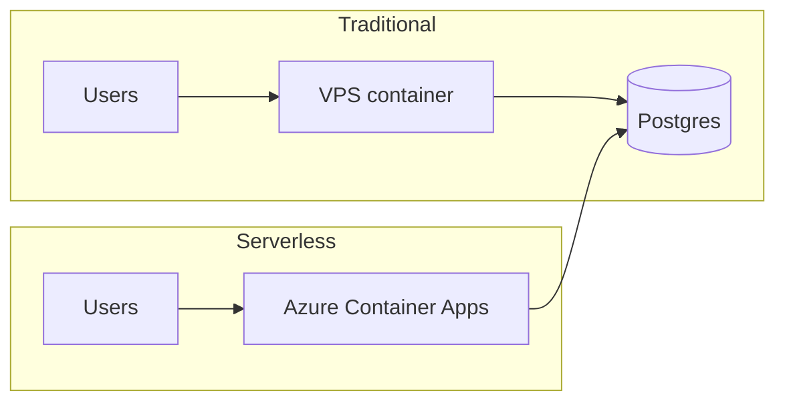

# Catalog and Orders Benchmark App

Benchmark subject for serverless vs traditional deployment comparison.

## Quick start

```bash
cp .env.example .env
npm install
npm run migrate
npm run seed
npm run dev
```

## Environment variables

| Var          | Default    | Description                |
| ------------ | ---------- | -------------------------- |
| PORT         | 8080       | Listen port                |
| DATABASE_URL | (required) | Postgres connection string |
| DB_POOL_MAX  | 5          | Pool size                  |
| DB_SSL       | true       | Enable SSL                 |
| INSTANCE_ID  | hostname   | Instance identity          |
| LOG_LEVEL    | info       | pino log level             |
| APP_VERSION  | 0.1.0      | Shown in /health           |

## Endpoints

- GET /health
- GET /health/db
- GET /api/categories
- GET /api/products
- GET /api/products/:id
- POST /api/orders
- GET /api/orders/:id
- GET /api/report?complexity=N

## Topologies



Docker:

```bash
docker compose up
```
